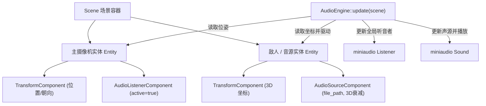

# Engine Audio 音频子系统 (`slrye/engine/audio`)

## 1. 模块定位与职责
`audio` 是引擎的核心多媒体子系统之一，负责高保真、低延迟的音频硬件驱动、音效播放以及 3D 空间音效（Spatial Audio）模拟。
本引擎采用方案 A，集成现代化单头文件专业跨平台音频引擎 **miniaudio**，支持各平台原生底层后端（Windows WASAPI / DirectSound、macOS CoreAudio、Linux ALSA / PulseAudio），具备零外部二进制 DLL 依赖、极高吞吐量与出色的 3D 空间混音能力。

---

## 2. 架构设计与 PImpl 头文件隔离

### 2.1 为什么采用 PImpl 隔离 `miniaudio.h`？
`miniaudio.h` 作为一个功能完备的音频库，包含大量的系统底层 API 引入（如 `<windows.h>`, `<mmsystem.h>` 等）。若将其直接暴露在公共头文件中：
1. 会造成极其严重的命名空间污染（如 Windows 宏 `min`, `max`, `near`, `far` 导致 glm 和 std 编译故障）；
2. 会显著拖慢全工程的 C++20 模块编译时间。

为此，引擎采用了严谨的 **PImpl（Pointer to Implementation）惯用法**：
- 公共头文件 `audio_engine.h` 与 `sound.h` 仅依赖基础 C++ 标准库类型与 `glm::vec3`，**绝不引入任何 miniaudio 符号**；
- 内部头文件 `sound_impl.h` 集中声明内部实现类 `Sound::Impl`，供 `sound.cpp` 和 `audio_engine.cpp` 跨编译单元安全访问；
- `#define MINIAUDIO_IMPLEMENTATION` 严格且唯一地收敛在 `audio_engine.cpp` 内部。

---

## 3. 核心类与成员详细说明

### 3.1 `AudioEngine`（音频主控制器）
* **定位**：音频子系统核心中枢，负责底层物理声卡硬件设备的初始化、全局音量调节、听音者位姿更新与 ECS 场景驱动。
* **主要成员与接口**：
  * `instance()`：全局单例安全访问点；
  * `initialize(std::string* error)`：初始化 miniaudio 内部引擎（`ma_engine`），捕获并配置默认音频输出设备；
  * `shutdown()`：安全销毁音频硬件上下文；
  * `set_master_volume(float)` / `master_volume()`：全局主音量控制标量 [0.0f, 1.0f+]；
  * `set_listener_position(const glm::vec3&)`：设置主听音者（人耳/摄像机）在世界空间中的三维位置；
  * `set_listener_orientation(const glm::vec3& forward, const glm::vec3& up)`：设置主听音者的视线前向与头顶上向，用于精准解算左右耳三维声像定位；
  * `load_sound(const std::filesystem::path&, bool is_3d, std::string* error)`：工厂方法，从本地文件解码并加载音频资源，返回拥有 RAII 生命周期的 `Sound` 句柄；
  * `play_one_shot(const std::filesystem::path&, float volume)`：免开销快速触发 2D 一次性音效（如点击声、UI 提示音）；
  * `update(Scene& scene)`：每帧驱动函数，深度遍历 ECS 实体，自动双向同步 `AudioListenerComponent` 与 `AudioSourceComponent`。

### 3.2 `Sound`（声音实例对象）
* **定位**：单个声音流或音频采样实例，支持独立调节播放状态、音量、音高与 3D 衰减。
* **主要成员与接口**：
  * `play()` / `pause()` / `stop()`：播放状态控制；
  * `is_playing()` / `is_looping()`：播放状态实时查询；
  * `set_looping(bool)`：开启/关闭循环播放（适合环境背景音、风声、引擎声）；
  * `set_volume(float)` / `volume()`：独立音量控制；
  * `set_pitch(float)` / `pitch()`：音高频率倍率（如 0.5f 为低沉慢放，2.0f 为高亢快放）；
  * `set_position(const glm::vec3&)` / `set_velocity(const glm::vec3&)`：3D 空间位姿与多普勒频移初速度；
  * `set_attenuation_distances(float min, float max)`：设置距离衰减曲线，[0, min] 为全音量区，[min, max] 平滑衰减，超出的距离归零。

---

## 4. ECS 实体组件系统（Scene / ECS）集成规范

音频子系统与引擎的 `Scene` 紧密协作，通过以下两个专用组件提供零代码配置体验：

### 4.1 `AudioListenerComponent`
* **字段说明**：
  * `bool active = true`：是否为当前处于活动状态的音频接收点。
* **使用规范**：通常挂载于拥有 `CameraComponent` 的主角或自由漫游摄像机实体上。

### 4.2 `AudioSourceComponent`
* **字段说明**：
  * `std::string file_path`：本地音频资源文件相对或绝对路径；
  * `float volume` / `float pitch`：初始音量与音高；
  * `bool looping`：是否持续循环；
  * `bool is_3d`：是否启用三维真实空间方位与衰减（若为 false 则作为背景 BGM 全局广播）；
  * `bool play_on_awake`：场景装载或实体生成后是否自动开始播放；
  * `float min_distance` / `float max_distance`：衰减起始与截止距离；
  * `std::shared_ptr<Sound> sound_instance`：运行时内部缓存的 Sound 句柄。
