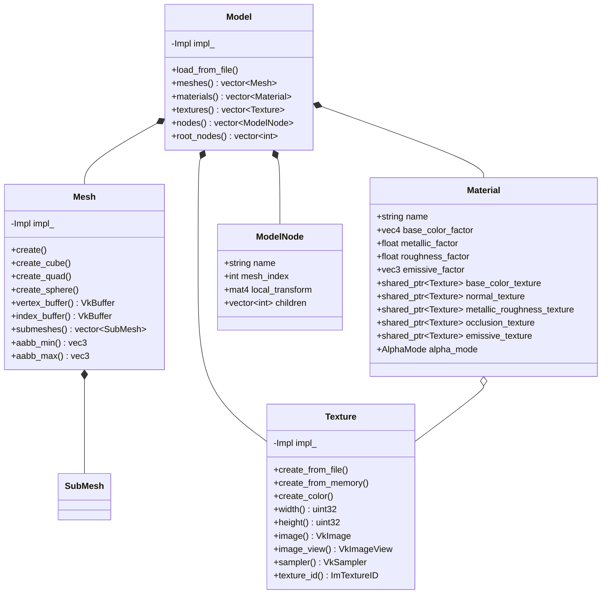

# Engine Resources 资源子系统 (`slrye/engine/resources`)

## 1. 模块定位与职责
`resources` 位于引擎的核心资源管理层，与 `audio`、`renderer` 和 `scene` 紧密协作，负责 2D 图片素材、3D 静态几何体网格、PBR 物理材质以及大型复合 3D 模型资产（glTF 2.0 / GLB）的加载、显存上传、生命周期维护及 ECS 关联。

在方案 A 中，本模块严格遵循以下技术选型：
1. **图像与纹理加载**：选用业内公认最稳定轻量的 **`stb_image`**，彻底规避 `libpng` 带来的臃肿依赖树与符号冲突；
2. **3D 模型解析**：集成最先进的 C++20 SIMD 解析库 **`fastgltf`**，提供比传统 Assimp 快 10~20 倍的高并发流式解构；
3. **显存管理**：依托 AMD **Vulkan Memory Allocator (VMA)**，通过暂存缓冲（Staging Buffer）实现全自动化且内存对齐的设备本地显存（Device Local）快速传输。

---

## 2. 为什么不使用 `libpng`，而选择 `stb_image`？

| 对比维度 | `libpng` | `stb_image` (本项目选择) |
| :--- | :--- | :--- |
| **外部依赖** | 强依赖 `zlib`、C 运行时配置复杂，Windows/MSVC 上极易出现动态链接冲突 | **零外部依赖**，单一标准头文件，自包含高性能 DEFLATE 解压引擎 |
| **支持格式** | 仅支持 PNG 单一格式 | **原生支持 PNG、JPEG、BMP、TGA、HDR、PSD** 等全部主流素材格式 |
| **显存对接** | 需要开发者手动逐行处理调色板、灰度、交错格式以及通道转换 | **一步强制展开为标准的 32 位 RGBA 像素布局**，直接匹配 Vulkan `VK_FORMAT_R8G8B8A8_UNORM` |
| **维护成本** | 随着 CMake 版本与 vcpkg 工具链升级维护成本高 | 工业级验证，维护零心智负担 |

---

## 3. 核心资产类与成员详细说明

### 3.1 `Texture`（2D 纹理资产）
* **职责**：封装经过 GPU 优化的只读纹理图像与采样器。
* **核心成员与方法**：
  * `create_from_file(context, path)`：从磁盘读取图片（PNG/JPG 等），创建暂存缓冲并传输至 Device Local `AllocatedImage`，生成线性采样器；
  * `create_from_memory(context, buffer, size)`：用于解析 glTF/GLB 内部嵌入的二进制图像块；
  * `create_color(context, rgba_color)`：快速生成 1x1 纯色基础纹理（如纯白 BaseColor、默认平坦法线 (128,128,255)）；
  * `texture_id()`：返回自动向 ImGui 注册的 `ImTextureID`，供 Inspector 面板实时无损预览缩略图。

### 3.2 `Vertex` 与 `SubMesh`
* **`Vertex`**：现代 PBR 顶点输入布局：
  * `position` (vec3) -> `location = 0`
  * `normal` (vec3) -> `location = 1`
  * `tex_coords` (vec2) -> `location = 2`
  * `tangent` (vec4) -> `location = 3`
  * `color` (vec4) -> `location = 4`
* **`SubMesh`**：子网格图元切片：
  * `first_index`, `index_count`, `first_vertex`, `vertex_count`；
  * `material_index`：关联的材质槽索引；
  * `aabb_min`, `aabb_max`：本切片的三维轴对称局部包围盒。

### 3.3 `Mesh`（静态几何体网格资产）
* **职责**：管理显存中的几何顶点缓冲（`vertex_buffer`）与索引缓冲（`index_buffer`）。
* **核心特性**：
  * **工厂模式**：提供 `create_cube()`（带独立法线与 UV 的 24 顶点立方体）、`create_quad()`（4 顶点平面）、`create_sphere()`（经纬网格球体）；
  * **测试友好性（Safe Degradation）**：若在单元测试或脱机无物理 GPU 环境下运行（`context` 为空句柄），安全退化保留 CPU 端的顶点与索引列表，确保几何拓扑计算与 AABB 验证 100% 稳定运行。

### 3.4 `Material`（PBR 物理材质资产）
* **职责**：遵循 glTF 2.0 金属-粗糙度（Metallic-Roughness）标准工作流。
* **属性涵盖**：
  * 因子：`base_color_factor`, `metallic_factor`, `roughness_factor`, `emissive_factor`；
  * 贴图通道：`base_color_texture`, `normal_texture`, `metallic_roughness_texture`, `occlusion_texture`, `emissive_texture`；
  * 渲染参数：`AlphaMode`（Opaque / Mask / Blend）、`alpha_cutoff` 剔除阈值、`double_sided` 双面渲染开关；
  * `create_default()`：构造带有白色底图的初始材质。

### 3.5 `Model`（基于 fastgltf 的复合 3D 模型资产）
* **职责**：从 `.gltf` 或 `.glb` 文件解构出的高阶场景模型树。
* **包含要素**：
  * `meshes()`：解析出的全部独立 Mesh 对象；
  * `materials()`：解析出的完整材质表；
  * `textures()`：从外部文件或内嵌 BufferView 提取并上传的全部纹理贴图；
  * `nodes()` / `root_nodes()`：包含 TRS（Translation, Rotation, Scale）或仿射变换矩阵的树状 `ModelNode` 结构；
  * `aabb_min()` / `aabb_max()`：聚合计算出的模型整体三维复合包围盒。

---

## 4. ECS 实体组件系统（Scene / ECS）绑定规范

在 `slrye/engine/scene/components.h` 中提供了一流的组件支持：

1. **`MeshComponent`**：
   * `std::shared_ptr<Mesh> mesh`：挂载的静态网格资源；
   * `std::string asset_path`：资源路径标识；
   * `uint32_t submesh_index`：指定的子图元索引。
2. **`MaterialComponent`**：
   * `std::shared_ptr<Material> material`：绑定的物理材质，渲染器以此材质的着色器参数进行管线装配。
3. **`ModelComponent`**：
   * `std::shared_ptr<Model> model`：完整复合 3D 模型句柄；
   * `std::string file_path`：模型文件存储路径。
